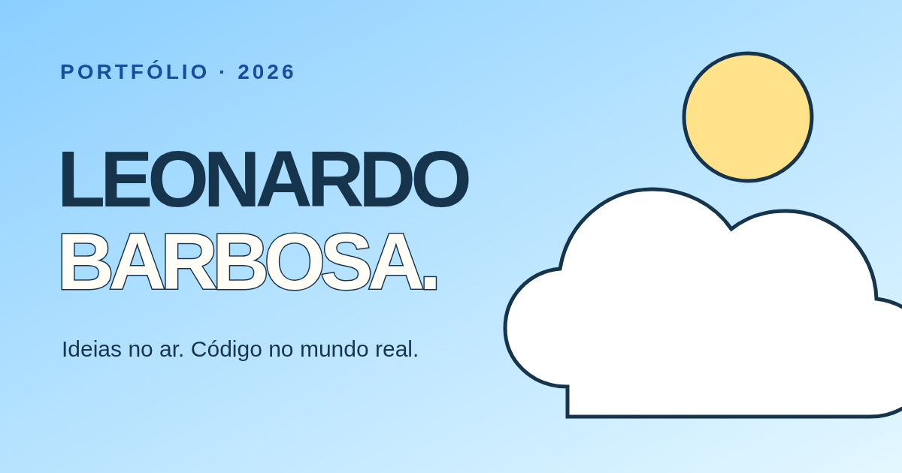

<div align="center">
  <a href="https://gitleonardoferreira.github.io/portifolio/">
    
  </a>
  <br />
  <a href="https://gitleonardoferreira.github.io/portifolio/">Acessar o portfólio</a>
  &nbsp;·&nbsp;
  <a href="docs/prompts/README.md">Conhecer os prompts e o processo criativo</a>
  &nbsp;·&nbsp;
  <a href="https://github.com/gitLeonardoFerreira/portifolio/actions/workflows/pages.yml">
    
  </a>
</div>

<br />

<table>
  <tr>
    <td width="68%" valign="middle">
      <h1>Oi, eu sou o Leonardo.</h1>
      <p>Estudante de Engenharia de Software na FIAP, em São Paulo. Gosto de transformar problemas concretos em aplicações claras e úteis — de automações em Python a produtos web.</p>
      <p>Este portfólio é um espaço para mostrar <strong>o que construí, como penso e o que estou aprendendo</strong>. Procuro uma oportunidade de estágio para continuar essa trajetória.</p>
      <p><strong>React · JavaScript · Vite · Tailwind CSS</strong></p>
    </td>
    <td width="32%" align="center" valign="middle">
      
    </td>
  </tr>
</table>

<div align="center">
  <a href="#uma-viagem-pelo-céu">A experiência</a>
  &nbsp;·&nbsp;
  <a href="#projetos-em-destaque">Projetos</a>
  &nbsp;·&nbsp;
  <a href="#executar-localmente">Executar</a>
  &nbsp;·&nbsp;
  <a href="#processo-criativo">Processo criativo</a>
</div>

## Uma viagem pelo céu

A página inicial mantém o céu em cena enquanto a rolagem, o toque ou os controles inferiores conduzem o visitante por **nove paradas**. Os conteúdos se aproximam como se a câmera avançasse entre nuvens; cada projeto tem seu próprio momento de leitura. Quem prefere movimento reduzido recebe uma versão com rolagem vertical convencional.

| Trecho da viagem | O que aparece                                                      |
| ---------------- | ------------------------------------------------------------------ |
| 01 · Abertura    | Apresentação de Leonardo e convite para explorar                   |
| 02–04 · Projetos | Rastro, Smart File Organizer e Cálculo de Frete, um por cena       |
| 05–07 · Sobre    | Retratos com troca de pose, história e trajetória                  |
| 08–09 · Contato  | Convite à conversa e formulário que prepara a mensagem no WhatsApp |

Os estudos de caso têm páginas próprias, com leitura convencional e uma curta transição de entrada. O menu permite ir diretamente a uma seção; os controles da cena também funcionam no celular.

## Projetos em destaque

| Projeto                                                                                                  | O problema explorado                                                                  | Tecnologias                  | Estado                                     |
| -------------------------------------------------------------------------------------------------------- | ------------------------------------------------------------------------------------- | ---------------------------- | ------------------------------------------ |
| [Rastro](https://gitleonardoferreira.github.io/portifolio/#/projetos/rastro)                             | Acompanhar solicitações, responsáveis e confirmação da solução sem perder o histórico | React, FastAPI, PostgreSQL   | Versão local funcional; sem demo hospedada |
| [Smart File Organizer](https://gitleonardoferreira.github.io/portifolio/#/projetos/smart-file-organizer) | Organizar arquivos com regras configuráveis e prévia antes de movê-los                | Python, CLI, YAML            | Código público                             |
| [Cálculo de Frete](https://gitleonardoferreira.github.io/portifolio/#/projetos/calculo-de-frete)         | Conectar formulário, API e regra de cálculo em um projeto de aprendizado              | React, Express, Tailwind CSS | Em evolução; sem demo hospedada            |

As páginas explicam o problema, a solução, decisões técnicas e aprendizados, com links para os respectivos repositórios. O site não atribui métricas ou demonstrações inexistentes aos projetos.

## Executar localmente

Use Node.js **20.19+ ou 22.12+** e npm:

```bash
git clone https://github.com/gitLeonardoFerreira/portifolio.git
cd portifolio
npm ci
npm run dev
```

Abra o endereço mostrado pelo Vite. Para conferir a versão antes de publicar:

```bash
npm run lint
npm run format:check
npm test
npm run build
npm run preview
```

<details>
<summary><strong>Como o projeto está organizado</strong></summary>

| Caminho                                       | Responsabilidade                                      |
| --------------------------------------------- | ----------------------------------------------------- |
| `src/App.jsx`                                 | Cenas do voo, navegação, estudos de caso e formulário |
| `src/flight.css`                              | Movimento e composição da experiência de voo          |
| `src/styles.css` e `src/styles-sky.css`       | Estilos da interface e da identidade de céu           |
| `src/data/projects.js`                        | Conteúdo dos três projetos                            |
| `src/data/portraits.js` e `public/portraits/` | Ordem, legendas e fotos das poses                     |
| `src/lib/contact.js`                          | Validação e montagem da mensagem para o WhatsApp      |
| `public/Leonardo_Barbosa_Curriculo.pdf`       | Currículo disponível para download                    |
| [`docs/prompts/`](docs/prompts/README.md)     | Pedidos originais, refinamentos e prompt consolidado  |

O formulário abre o WhatsApp com a conversa preenchida para que a pessoa revise e envie a mensagem. Ele não envia dados silenciosamente em segundo plano.

</details>

<details>
<summary><strong>Publicação e acessibilidade</strong></summary>

O workflow [Publicar prévia no GitHub Pages](.github/workflows/pages.yml) valida o código e publica automaticamente a branch `main`. O build usa a base `/portifolio/` e `HashRouter`, permitindo abrir os estudos de caso diretamente no GitHub Pages:

```bash
GITHUB_PAGES=true npm run build
GITHUB_PAGES=true npm run preview
```

O projeto também está preparado para a Vercel: fora do GitHub Pages, usa `BrowserRouter`, com redirecionamento de rotas em `vercel.json`.

A experiência oferece navegação por teclado, foco visível, rótulos para controles, alternativas para interações por toque e uma versão estável para `prefers-reduced-motion`.

</details>

## Processo criativo

O projeto evoluiu por iterações: um primeiro briefing editorial, a mudança para um céu azul-claro com fotos na seção Sobre e, por fim, a navegação em voo que continua até o contato. A pasta [**Prompts e decisões do portfólio**](docs/prompts/README.md) separa as solicitações originais dos refinamentos e de uma síntese posterior da versão publicada. Isso permite acompanhar o raciocínio sem confundir ideias iniciais com o resultado final.

---

<div align="center">
  <strong>Ideias no ar. Código no mundo real.</strong>
  <br />
  <a href="https://gitleonardoferreira.github.io/portifolio/">Portfólio</a>
  &nbsp;·&nbsp;
  <a href="https://www.linkedin.com/in/leonardo-barbosa-102615-">LinkedIn</a>
  &nbsp;·&nbsp;
  <a href="mailto:leomurilobarbosa@gmail.com">E-mail</a>
</div>
